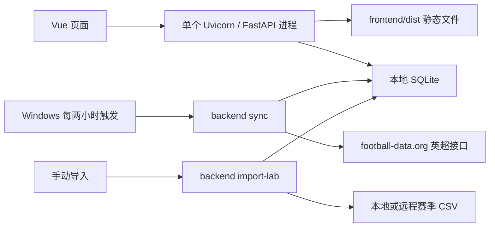
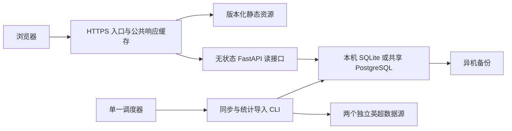
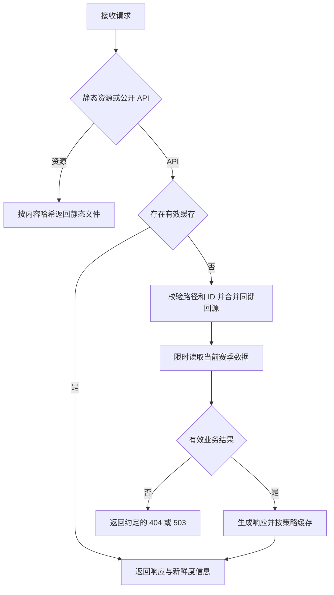
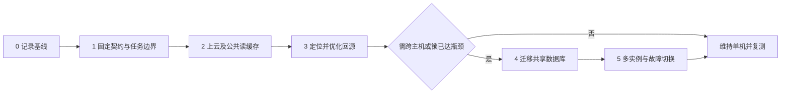
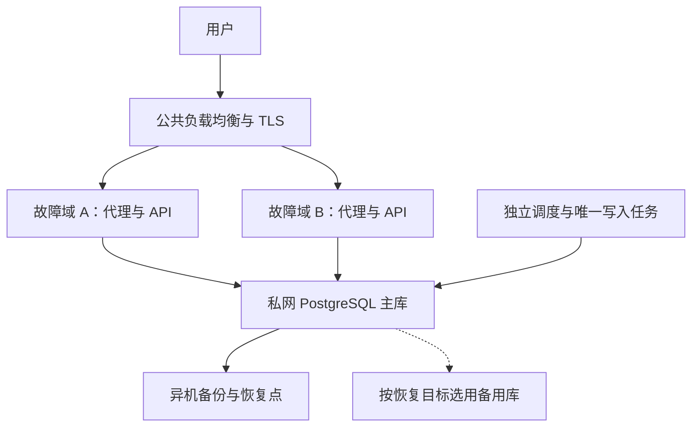

# FootScope 项目高并发架构升级与实施方案

设计基准为 2026-11-19 的当前工作树，包含已经接入的本赛季英超战术实验室。建议近期保留单机单体，把第一笔工程投入用于测量和复用联赛快照。跨主机部署时再让多个 API 实例共用 PostgreSQL。是否扩容，以第 10 节同负载下的延迟、错误率、资源余量和故障演练结果决定。

## 1. 项目现状与当前架构分析

| 入口与文件 | 实际调用链与数据边界 |
|---|---|
| 前端启动 | [main.ts](frontend/src/main.ts) 挂载 Vue 3，TypeScript + Vite 构建。开发时 [vite.config.ts](frontend/vite.config.ts) 代理 /api。生产构建产物由 FastAPI 提供。哈希路由切换组件，轮次切换和名单搜索主要在浏览器内完成。 |
| 比赛中心 | [App.vue](frontend/src/App.vue) 在挂载、页面恢复可见、手动刷新和可见页面每 60 秒调用 GET /api/v1/competitions/PL。即使用户停留在实验室也会刷新。loading 防止同一页面请求重叠，跨用户仍各自请求。 |
| 联赛读取 | [main.py](backend/main.py) 的 premier_league → [storage.py](backend/storage.py) 的 read_snapshot。在同一读事务取最新赛季、全部球队、该季积分榜和按开球时间排序的赛程，关闭连接后拼装主客队、计算缓存是否超过 24 小时，构造 JSONResponse。无快照返回 503。 |
| 球队与比赛 | [TeamRoster.vue](frontend/src/components/TeamRoster.vue) 挂载时读取 /api/v1/teams/{id}。read_team 校验本季积分榜成员，读整季 squads_json，反序列化后取一队。[SeasonMatches.vue](frontend/src/components/SeasonMatches.vue) 切换比赛时请求 /api/v1/lab/matches/{id}，取消旧请求。[lab.py](backend/lab.py) 的 read_match_stats 以比赛主键定位，校验赛季、状态、开球时间、主客队和比分后关联统计。未导入或未完赛可返回 200 和空统计，非本季 ID 返回 404。 |
| 写入 | [football_data.py](backend/football_data.py) 的 sync 通过同步 httpx 拉取 standings、matches，normalize 后调用 save_snapshot。球队名单按独立的新鲜度检查更新。连接失败或部分 5xx 有退避，429 结束该次抓取。读取网页不会触发抓取。 |
| 实验室处理 | import_match_stats 在取得 CSV 后开启 BEGIN IMMEDIATE，在事务内逐行匹配、调用 normalize_stats、按 match_id 更新，计算射正率并汇总覆盖数。入库键与比分校验防止错误关联。该任务独立于赛程同步。 |
| 部署与资产 | [CLI](backend/__main__.py) 的 serve 监听 127.0.0.1，默认端口 8000；create_app 初始化表并挂载 /assets，超过 1 KiB 的合适响应进入 GZip 中间件。[注册脚本](scripts/register-sync-task.ps1) 在 Windows 用户登录时运行单独的同步进程，IgnoreNew 防止同机任务重入，最长 5 分钟。队徽由 [team_crests.py](backend/team_crests.py) 离线下载并随前端构建。仓库提供本地启动流程，尚未提供云部署清单。 |

数据库使用 Python 3.12 标准库 sqlite3，connect 每次打开文件、启用外键、设置 5 秒锁等待，调用方用 closing 关闭。seasons、teams、standings、matches 保存赛程快照，roster_snapshots 按季保存名单，lab_match_stats 按场保存统计并随删除比赛级联清理。save_snapshot 用事务、同步开始时间和 UPSERT 防止较旧写入覆盖新数据。请求路由为同步 def，数据库调用占用线程；网络抓取、time.sleep 和较长写事务发生在 CLI 进程。服务端共享业务状态在数据库文件中，代码中未见用户会话、响应缓存或请求间共用的数据库连接。多个进程可以共享本机文件，独立主机各自的文件则会产生不同视图。

## 2. 并发需求与性能目标

本次只读核对得到 20 支球队、380 场赛程、100 条逐场统计。当前一份联赛紧凑 JSON 为 116,390 字节，本地 gzip 样本为 5,843 字节。后者是体量估计，线上结果取决于压缩级别和响应头。未测量服务延迟或吞吐量。

设 N 为同时在线人数，v 为可见页面比例，a 为平均每名在线用户每分钟额外触发的 API 请求数，覆盖首访、切回页面、选球队和选比赛。入口平均 RPS = N × (v + a) / 60。一次打开实验室可能同时需要联赛快照和单场详情。下表只计 API，静态文件、健康检查和任务访问另计。

| 模型 | v | a | 100 在线 | 1,000 在线 | 10,000 在线 |
|---|---:|---:|---:|---:|---:|
| 轻量，多数页面停在后台 | 0.4 | 0.2 | 1 | 10 | 100 |
| 中等，持续浏览并偶尔切换比赛 | 0.8 | 1 | 3 | 30 | 300 |
| 高负载，所有人前台且频繁交互 | 1 | 5 | 10 | 100 | 1,000 |

**拟定验收目标**。以同地域客户端经 HTTPS 收到完整响应计时，分别按路由统计。联赛快照平均 ≤100 ms、P95 ≤250 ms、P99 ≤500 ms；球队与单场详情平均 ≤80 ms、P95 ≤200 ms、P99 ≤400 ms。正常稳态意外状态码、超时和传输失败合计 <0.1%，合法请求被限流计入失败。预期 404 和未完赛空值按契约单独校验。以连续 15 分钟 CPU <70%、内存工作集 <75%、无持续换页为余量目标，同时记录单核饱和、容器限额、磁盘等待和突发型 CPU 积分。

| 规划档 | 稳态入口目标（中等 / 高） | 负载机短峰测试目标 | 应用在途请求保护初值 |
|---|---|---|---|
| 100 | 3 / 10 RPS | 30 RPS | 单实例 16 |
| 1,000 | 30 / 100 RPS | 300 RPS | 单实例 32 |
| 10,000 | 300 / 1,000 RPS | 3,000 RPS | 每实例 64，实例数由实测回源率决定 |
| 10,000+ | 按实测 v、a 与热点分布重算 | 用发布日峰值及增长预测回放 | 按安全吞吐和故障余量重算 |

在途是正在处理或等待资源的请求。Little 定律 L≈λW，例如 1,000 RPS、平均 80 ms 对应入口平均 80 个在途。缓存命中率 95% 时，1,000 个可缓存请求每秒约有 50 个回源；不可缓存请求须另加。若源站每次消耗 10 ms CPU，持续 100 次回源/秒就约占满一核。若全部为当前样本大小的压缩快照，1,000 RPS 仅响应体就约 47 Mbps。上述时间、命中率和在途上限均为待测参数。边缘连接、应用在途和数据库连接分别设限，不能按在线人数开连接。

## 3. 当前架构瓶颈及风险

| 代码或只读数据已确认 | 有条件的性能风险 | 验证信号 |
|---|---|---|
| 三个业务路由使用 no-store；联赛路由每次重新查表、拼装和序列化 | 同一分钟大量相同轮询，可能先耗尽 CPU、线程或出口带宽 | 分离 SQL、组装、JSON 和 gzip 时间；比较缓存开关前后的回源数、CPU 秒/千请求 |
| 名单每次解析整季 JSON；历史球队也进入联赛快照中间字典 | 球队热点放大分配量和读取量 | 观察同一球队与随机球队 P95、返回大小、反序列化耗时 |
| 当前库 journal_mode 为 delete；更新和 CSV 导入持写事务，数据库位于本机 | 长读与提交互相等待、写任务相互等待，线程可能在 5 秒锁超时前堆积 | 同步、导入与网页请求同时执行，记录持锁时长、busy 次数及尾延迟 |
| /health 直接返回 ok；Web 进程还发静态资源 | 空库或读取失败时实例仍可接流；冷启动加载图片消耗源站连接 | 空库演练、读取失败演练、首次加载瀑布图与带宽 |
| IgnoreNew 仅对同机注册任务有效，实验室统计独立导入 | 多节点调度重复消耗上游配额；赛程成功不代表统计已导入 | 统计任务重叠、最新成功时间、已结束与有效统计的覆盖差值 |

目前无法据代码确定哪一项首先饱和，也没有证据说明已耗尽连接。SQLite 当前没有传统服务器连接池耗尽问题，需先观察工作线程、文件锁和排队。真正的容量拐点以第 10 节试验确定。

## 4. 目标架构设计

推荐目标为同一版本的模块化单体，Web 和采集任务使用不同入口。初期缓存公共 GET 结果，多主机阶段采用独立数据库。

请求处理流程以公开 GET 为例。详情缺失、空库和上游迟到具有不同的业务语义。

## 5. 核心技术选型与理由

| 决策与引入阶段 | 对 FootScope 的作用及较简单的起点 | 成本、实施边界和下一次升级信号 |
|---|---|---|
| FastAPI + Uvicorn，阶段 1–2 | 沿用同步数据库读取和现有类型契约。先测 1 个 worker，再对照 2 个。 | 每个 worker 有独立内存、线程和连接池。同步驱动置于普通 def；仅在大量并发等待且可使用原生异步驱动时试验 async。把同步 sqlite3 放进 async def 会阻塞事件循环。 |
| Nginx，首次上云 | 一处终止 TLS、直发前端、缓存公开 GET。一个源站先用普通反代，扩容后用 least_conn。 | 初值连接上游 1 秒、读超时 3 秒，短于页面 10 秒；仅幂等 GET 在未发响应时对另一实例重试一次。使用共享 IP 友好的突发额度，先观察再开启每 IP 20 请求/秒、burst 40 的 API 限流。活动人数聚集在同一 NAT 时需放宽；另配全局回源并发保护。 |
| SQLite，阶段 1–3 | 小事务、按请求关闭连接。先测 WAL 和默认日志模式。已有 matches(season_id,kickoff_utc)、主键及积分榜复合键。用 EXPLAIN QUERY PLAN 检查排序及扫描，只有实测慢且有选择性时增加 standings(season_id,position) 等索引。 | WAL 允许读写交错，仍有单写者，需监控 checkpoint 和长读事务；数据库放同机本地持久卷。先缓存联赛响应、按球队拆名单读取，再考虑迁移。[SQLite WAL 文档](https://www.sqlite.org/wal.html) |
| PostgreSQL + 有界连接池，阶段 4 | 跨主机共享写入，或优化后锁等待仍导致 SLO 失败时切换；保留现有业务函数，驱动换为 psycopg。 | 初值每 worker 池上限 5，无额外溢出，等池 ≤200 ms。以两实例各两 worker 为例，Web 最多 20 条，任务 2 条，运维与迁移预留 8 条，需要至少 30 条可用预算；蓝绿重叠时 Web 预算翻倍。用实际连接持有时间 × 回源 RPS 校准，超出数据库预算则限制在途。记录慢 SQL，副本环境用 EXPLAIN ANALYZE 与缓冲统计定位。 |
| 响应缓存，阶段 2；Redis 按需 | 先让 Nginx 缓存公共 200 GET。逻辑键包含接口版本、赛事、赛季、实体及数据版本，如 lab:v1:PL:2026:match:560542:rev17。边缘可用规范化 URI + 短 TTL，无需逐请求到 DB 查版本。 | 联赛 TTL 30 秒，比赛 60 秒，阵容 5 分钟，未导入统计 15 秒。误差预算等于数据源延迟加缓存窗口。提交后递增相应版本，旧键自然过期；比分修订须同时影响比赛与联赛，新赛季切换须刷新所有“当前赛季”入口。多机缓存的重复构建使数据库超预算时才增加 Redis 和其监控、内存、故障处理。 |
| 缓存保护，阶段 2 | 校验 ID 范围、规范查询串、按已知资源缓存；热门键用 proxy_cache_lock 合并冷启动请求。可对受限数量 404 短缓存 5 秒。 | TTL 加最多 10% 抖动或分批预热。503 不写缓存，源站故障时仅在限定窗口（如 60 秒）提供已标注年龄的旧成功响应；过期后明确失败。仅对公开匿名路由启用，拒绝缓存带认证或私有响应。必须同步调整当前 no-store 策略。 |
| 采集 CLI + 单一 timer，阶段 1 | 同步和 CSV 导入已在 HTTP 外。Linux 使用独立 systemd timer 或定时运行一次性容器；按上游发布节奏及允许频率分别调度。 | HTTP 超时、任务总时限、指数退避和抖动，429 尊重 Retry-After；区分瞬时错误和数据格式错误，后者记录并停止重试。用数据库锁或同机文件锁阻止重入，保留现有版本比较和唯一键。只有任务积压持续超过更新窗口或需并行回填时才引入持久队列、确认、失败记录与重放。 |
| Docker Compose，阶段 2 可选 | systemd + venv 已足够单机运行。需要可复现的依赖、双版本切流时，构建同一镜像供 API 和任务使用，前端 dist 独立发布。 | 增加镜像仓库、补丁、卷和网络运维。多主机可先用每机 Compose + 云负载均衡。服务组众多、人工滚动发布无法满足恢复时限时再评估 Kubernetes。 |
| 日志和指标，阶段 0 起 | 先用代理访问日志、任务日志及宿主监控。记录 request_id、路由模板、状态、字节数、总耗时、上游耗时、缓存状态、发布版本。任务记录赛季、批次、覆盖率、重试和上次成功时间。 | 直方图按路由，避免用比赛 ID 作指标标签。多实例难以手动关联时上 Prometheus + Grafana 或云监控；采集线程/连接等待、CPU、RSS、磁盘、出口、数据库锁、缓存命中与回源。先保留 7 天明细，按实际排障需要扩展。 |

## 6. 三种架构方案对比

| 维度 | A 优化现有单体 | B 模块化单体 + 多实例 | C 微服务 |
|---|---|---|---|
| 容量前提 | 通过重复读缓存和单机资源余量达到目标；受一台机器上限约束 | 公共热点在边缘命中，共享数据库能承受剩余回源；可独立增加 Web 副本 | 热点领域能独立扩容；共享数据、扇出和跨服务延迟仍需实测 |
| 开发 / 维护 | 低 / 低，集中排查 | 中 / 中，增加契约、池预算和迁移运维 | 高 / 高，增加网络契约、跨服务一致性与链路排查 |
| 资源 / 部署 | 一机一库，发布简单 | 先同机多进程，后独立主机和数据库，需摘流 | 各服务、任务及观测分别运行，最低常驻成本更高 |
| 扩展方向 | 加缓存、加核或 worker | 业务分模块演进，Web 与采集分别部署 | 分团队、分领域发布和扩缩容 |
| 改动范围 / 适用阶段 | 主要改读路径和入口，适合验证产品和 100 在线档 | 保留 Vue、FastAPI、normalize 及接口，改存储和部署，适合持续增长 | 拆数据所有权、服务接口、调用链，适合确有独立生命周期的业务 |

## 7. 最终推荐架构及决策依据

采用 **A 起步、B 作为目标**。本项目热点是所有用户读取相同的当季比赛集合。复用一份序列化结果可以同时减少 SQL、CPU 和响应压缩开销；增加独立服务对这条热点没有直接收益。100 在线先验证单机。1,000 在线先验证缓存和两个 worker，达到目标即可停止改造。10,000 在线以 B 做容量候选，要求能够在失去一个实例后承载正常流量。10,000+ 按实际每千请求成本、头部路径占比及数据库等待决定增加哪一层资源。

## 8. 分阶段升级实施计划

以下均为未来实施单元。每一阶段只发布表中列出的变化，并保留上一版制品及同一套回归用例。每次改变 worker、索引、缓存或日志模式，单独保留一组对照数据。

| 阶段、目标与前置条件 | 工程范围、组件和数据流 | 功能影响、风险与验收 | 发布及回滚 |
|---|---|---|---|
| 0　取得可重复的基准。前置为冻结代码、数据快照和机器规格 | 后续新增 perf/ 下的 k6 场景与样本清单；在副本复现 README 的 serve，记录生产构建、数据哈希、并发和机器配置 | 对照三个 API 的状态和内容，记录冷暖、无写入和导入重叠的三次基线，输出第 10 节指标。避免让压测任务访问真实上游 | 独立验证，无需上线；移除测试流量即可恢复 |
| 1　固定模块边界与同步可靠性。前置为接口基线 | backend/main.py 保留 HTTP 映射；storage.py、lab.py 暴露明确的读取和事务写入入口；football_data.py 保留抓取和 normalize；明确 frontend/src/types.ts 的空值契约。CLI 分开登记同步与导入成功时间。增加 Linux 单一调度和备份任务 | 前端沿用同一 API；同批导入两次、旧批次后到、上游失败、空库和空统计均须通过。校验主客队顺序、零射门射正率、赛季切换以及积分榜完整性 | 可单独上线。迁移调度前停旧触发器，失败则恢复旧 CLI 和唯一的旧触发器 |
| 2　公开入口并消除重复回源。前置为域名、证书、备份恢复成功 | 新增 deploy/nginx 配置；按需新增 Dockerfile、Compose。入口直发 frontend/dist；main.py 对匿名 GET 写明确缓存头；App.vue 给自动刷新加随机错峰，保留人工刷新。容器内监听私网接口，宿主只公开 HTTPS。增加存活/就绪探针和访问日志 | 检查旧前端兼容、静态资源哈希及新鲜度，比较 1/2 worker。先旁路缓存，再启用联赛缓存；中等模型须达标，同键并发冷启动不能形成等量回源 | 可单独上线。保留上一套前端资源；代理切回旧 upstream 或 bypass 缓存，reload 后复验 |
| 3　优化已定位的读写热点。前置为 SQL、压缩和锁耗时分布 | storage.py 先复用已生成的快照字节或收窄球队查询；若名单热点突出，按 season_id 与 team_id 物化单队名单。lab.py 将可独立完成的 CSV 解析移出写事务，提交时复核当前赛季和比赛签名。副本单独试验 WAL 与候选索引 | 同一版数据逐字段相等，导入异常应整批回滚。重点比较有写入时 P99、busy、写事务时长及磁盘增长。仅上线有可重复收益的项 | 各项可独立发布。保留旧读取路径；停写并完成 checkpoint 后再切日志模式；新索引按测量结果移除 |
| 4　引入 PostgreSQL。前置为明确的跨主机需求或单机调优仍不达标 | 为 storage.py 与 lab.py 的现有调用契约实现 PostgreSQL 适配，新增版本化 migrations，统一 DATABASE_URL。CLI 与 Web 使用同一数据库。先全量复制全部赛季和外键，再影子比对只读响应；短暂停调度及手动写入，补齐最后差量，切唯一写入者 | 保留比赛 ID、外键级联、时间排序、UPSERT 防旧写和空统计语义。逐表计数、唯一性、完整响应及覆盖率全部一致，池等待低于预算并通过恢复演练 | 可先以单 API + 新库上线。切写前可直接回旧连接；新库已有写入时先停写、反向同步并校验差量，再切回 |
| 5　横向扩容及低停机发布。前置为共享库、无本地业务状态、实例级指标 | deploy/ 添加第二 API 实例、负载均衡、就绪探针和摘流；调度独立。新版本先单实例接少量流量，逐步扩大；新旧版本共存期间先扩表，再切读写，最后收缩旧字段 | 两实例返回同一赛季及统计版本。摘除一个实例，在正常负载下检查错误率和池上限；确认部署期间无双调度。通过 10,000 在线模型及故障用例后才宣称该档容量 | 可独立增加副本。停止向新版本分流，等待在途请求结束，回退镜像；数据库暂保兼容模式 |

## 9. 服务器部署与资源规划

以 AWS Lightsail 美国东部（弗吉尼亚北部）Linux 通用型、公共 IPv4 套餐为估算例，连续运行整月，美元、未税、不计试用优惠。以下是**预算级别**，不构成地区报价或购买建议。备份存储、负载均衡、跨区传输、超额公网流量和托管数据库按实际用量单列。用户若主要在中国境内，应在实际候选地域重新测网络延迟并询价。[AWS 官方定价](https://aws.amazon.com/lightsail/pricing/)

| 形态 | 起测配置及组件 | 路径、单点与恢复 | 月预算量级 |
|---|---|---|---|
| 单机 | 2 vCPU、2 GB、60 GB SSD；Nginx、单 worker、SQLite、timer | HTTPS → 代理 → API → 本地盘；整机单点。每日数据库一致性备份到异机并保留前端制品 | 主机约 10–20 美元 |
| 单机多容器 | 2 vCPU、4 GB、80 GB SSD；代理、API、一次性任务容器；SQLite 同机持久卷 | 流程相同，重建容器可复用卷；磁盘和主机仍是单点。备份必须包含数据库且独立于卷 | 主机约 20–35 美元 |
| 同机多实例 | 2 vCPU、8 GB、160 GB SSD 起；两个 API 容器，共用一个数据库进程及卷 | 代理 → 两实例 → 本机 PostgreSQL。进程故障可摘流，故障域仍是一台机器；用数据库原生备份异机恢复 | 主机约 40–65 美元 |
| 多服务器 | 两台应用各 2 vCPU、4 GB、80 GB；独立数据库起测 2 vCPU、8 GB、160 GB；云 LB | LB → 不同故障域的应用 → 私网数据库。单主库仍是单点，需按恢复目标选择热备或托管高可用 | 三台主机约 80–135 美元，另计 LB、备份、备用库及流量 |

先把恢复目标订为 RPO 24 小时、RTO 2 小时，按实际演练修订。SQLite 用在线备份接口或停写一致性快照；PostgreSQL 先定时逻辑备份，若要求分钟级 RPO 再用基础备份和 WAL 归档。每日备份保留 7 份、每周保留 4 份，每月在空主机恢复并核对赛季和统计。密钥从运行时环境或云密钥服务注入，采集令牌仅给任务，API 使用只读数据库账号。把 create_app 中初始化表的动作前移至部署迁移，否则只读账号无法承担启动 DDL。

## 10. 压力测试及验收标准

选择 k6，单个 JavaScript 脚本即可复现浏览会话和固定到达率，适合已有前端工具经验的个人开发者。基线使用单台异机发压；到 10,000 虚拟用户先验证发压端 CPU、连接及网络余量，必要时按不重叠的用户编号分机。[k6 固定到达率说明](https://grafana.com/docs/k6/latest/using-k6/scenarios/executors/constant-arrival-rate/)

1. **固定环境。** 记录 commit 与工作树差异、镜像、Python/Node/内核、worker 数、池和缓存配置、CPU 积分、磁盘类型、地域与测试时间。使用生产前端构建和 TLS。初次同地域测试覆盖服务器延迟，另从用户地域测公网首屏；报告分别记录本地 SSD 与云盘、真实 TLS 与本机测试之间的差异。
2. **准备数据。** 复制脱敏数据库并生成只读 fixture 清单，包含本季全部球队和比赛、已完赛和未完赛 ID、零值和不存在 ID。固定随机种子。数据写入测试只用独立数据库和已保存的上游文件，写入前记录校验和，禁止打真实上游。保留一份无赛季快照的副本验证 503。
3. **生成负载。** 会话模型用 ramping-vus 分别升至 100、1,000、10,000 个会话，给首次进入与轮询间隔错峰，按第 2 节 v 与 a 控制思考时间。固定到达率模型一轮只发一个 API 请求，按表中 RPS 发起，避免服务越慢测试施压越小。中等模型每分钟 0.8 次轮询、1 次额外请求，可将额外请求按 20% 联赛、20% 球队、60% 比赛分配；总体比例约 56/11/33。高负载模型沿用相同分配规则重新计算。分别测热点集中与全赛季随机选择。
4. **执行节奏。** 每档预热 5 分钟，升压 5 分钟、稳态 15 分钟、降压 2 分钟；基线和候选各重复三次。单测冷首页并计入资源下载，然后以已加载页面测 API。先对一个实例关闭缓存找回源容量，再开缓存测入口容量。记录 k6 实际发出、成功、失败及 dropped_iterations，后者须为零；发压机饱和的轮次作废。
5. **确定安全容量。** 相同版本把固定 RPS 每档提高 25%，直至某一路由违反第 2 节目标。取三轮都达标的最高稳态 RPS，再用其 70% 作为初始调度预算。多实例按 N−1 台仍满足正常回源量设计。上线后以实际命中率、用户行为和结果新鲜度复算。

| 专项 | 如何施压或注入故障 | 通过标准与定位 |
|---|---|---|
| 三档在线 | 各跑轻、中、高三种模型，分别汇总各端点及两类比赛 | 正常稳态满足第 2 节全部指标，JSON 契约与固定样本一致；比较同负载的 P95/P99、CPU 秒/千请求、SQL 次数和出口字节 |
| 比赛日突发 | 从高负载稳态瞬时升至 3 倍并保持 60 秒，再恢复；单独测试同一秒集中首访 | 无崩溃、无数据错配，主动拒绝与 5xx 分开报告；突发期间意外 5xx <1%，恢复后 60 秒内重达稳态。429 即代表该峰值不能宣称全量承载 |
| 数据库繁忙 | 旁路缓存，随机读取；同时回放 sync 和 import-lab，并模拟比分修订 | 无半批数据或错误关联，正常负载仍达标；按线程等待、池等待、事务时间、锁和磁盘延迟逐层定位 |
| 缓存失效 | 仅在测试环境清热门键或令多键同刻过期，持续访问同一详情和联赛快照 | 同一键每个缓存节点每轮只允许一个正常填充，源站在途不超保护值；过期窗口结束后值与数据库一致 |
| 实例故障 | 稳态下摘除或终止一个 API 副本，观察就绪与分流；恢复后重新加入 | 目标 10 秒内摘流，1 分钟内恢复正常 SLO，另一副本能承担正常流量。分别记录故障窗口错误率、积压及恢复时间 |
| 长稳与恢复 | 预期峰值的 70% 连跑 2 小时，在独立环境从备份恢复 | 内存、连接、日志盘空间无持续失控增长；实际 RPO/RTO 满足第 9 节，恢复后逐表核对并抽验三个 API |

优先比较代理总延迟与 upstream 时间。差距大先查网络、TLS 和代理队列；源站慢且 SQL 快，检查线程、组装与压缩；SQL 慢再看执行计划、锁和磁盘。所有对照保留 k6 摘要、按路由直方图、系统指标及配置差异。平均值改善但 P99 或新鲜度退化时不通过验收。

## 11. 风险控制与回滚方案

| 风险 | 预防与发现 | 故障处置 |
|---|---|---|
| 响应契约、名单及空统计回归 | 前端消费固定 JSON 对照，新旧接口影子比对相同版本，覆盖 0、null、404、503 | 流量切回旧版本，共用向后兼容的表，保留旧静态资源至浏览器缓存过期 |
| 数据库迁移漏数、回滚丢新写 | 迁移前备份并实际恢复；主外键、每季行数、统计字段和抽样响应比对，切换时冻结所有写者 | 依据第 8 节区分切写前后；有差量先补回，确认唯一主库后恢复调度 |
| 缓存错误、统计源迟到 | 单独追踪赛程、名单、实验室更新时间；展示来源和覆盖率；明确短 TTL 与版本切换 | 按版本弃用旧键，旁路缓存，限制回源量。保留最后有效数据并提示延迟 |
| 多实例读到不同数据、单个实例失效 | 共享数据库、统一配置和版本；/health 用于存活，另增就绪探针做有时限的轻量读取与本季数据检查 | 代理被动检查连接失败并由外部探针主动摘流，等待连接排空后更新；单实例发布需接受短暂停机 |
| 重复调度、漏导入或任务丢失 | 调度唯一，按来源/赛季/批次登记状态和输入摘要，成功标记与写入同事务；覆盖数对照已完赛数 | 超时租约可恢复，幂等重放；若以后上队列则提交事务后确认消息，失败批次限次重试，持久保存失败原因 |
| 数据库单点、磁盘写满、密钥误用 | 异机备份、空间告警、恢复演练；日志去令牌；应用、任务和迁移角色分权 | 切只读旧成功快照并标时间，恢复数据库后逐步开流；轮换泄露凭证 |
| 组件维护超出预算 | 为每次新增组件记录基线、目标、月成本和退出条件 | 无可重复收益则停在上一阶段，移除该层依赖，保留回归数据 |

## 12. 后续扩展路线

- **下一个比赛日先收集行为数据。** 完成入口计数、响应大小和同步日志的关联。连续两次比赛日观察实际每人请求频率、峰值持续时间及缓存命中率，再决定是否需要第二个 worker。
- **读副本。** 在已缓存公共响应、已优化查询且主库读 CPU 或 I/O 仍持续突破预算时评估。可容忍延迟的历史读走副本，最新比分修订和导入覆盖校验读主库；以复制延迟和故障切换演练决定上线。
- **分区与分片。** 将来若接入逐事件坐标，先估算每场事件数、行宽、索引与保留年限，再按赛季分区或归档。单库在合理硬件和分区下仍无法达到写入或恢复目标，且能确定跨分片查询代价时，才设计按赛事或赛季分片。
- **独立任务服务。** 如果逐事件处理积压或算法迭代需要独立发布，可先拆计算 worker，继续通过版本化结果供现有 API 读取。只有多个领域确实需要单独扩缩容、发布及数据所有权时，再重新评估方案 C。
